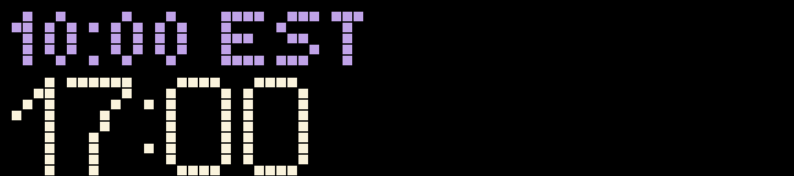

# Jetlag Dial

Convert every hour between two cities on a selected date, including daylight saving changes.

Check both cities on the date of the call. If one city has switched daylight saving time and the other has not, the bar uses the dates from the host’s time-zone database instead of assuming a fixed difference.

## Compare two meeting hours

1. Set the source and destination IANA zone names, date and starting hour. Open the app with the companion running.
2. Read the source hour and abbreviation on the top line. The larger time below is the destination hour.
3. Turn one step to compare the next source hour. The recording goes from 09:00 to 10:00 Toronto time and from 16:00 to 17:00 in Kyiv.


## Confirm the day as well as the time

1. Turn back to the proposed hour. Read the destination date on the rear before placing the meeting on a calendar.
2. If the selected date has a missing spring-forward hour, that source hour is marked **Skipped**. A repeated fall-back hour has two entries, one for each real instant.
3. Pin the agreed hour with **Start** if several people are comparing it at the desk.



## Example from the emulator

The recording uses 18 November 2026. On that date 09:00 in Toronto corresponds to 16:00 in Kyiv. An empty date setting uses the current date in the source zone. The rear also indicates when the destination is on another calendar day. The conversion used the host’s IANA time-zone database.

## Set up the source

Set from_zone and to_zone to IANA names, date to YYYY-MM-DD (or leave empty for the current source-zone date), and start_hour to the first displayed hour. Turn through all hours. Missing spring-forward hours are marked skipped, and both fall-back occurrences get a separate destination reading.

## Connect the bar

Copy companion/example.json to a private config.json and adjust it for your source. From the project folder run `python3 companion/serve.py --config config.json`. Use Python 3.10+. Set Local companion URL to `http://127.0.0.1:8770/reading` on the emulator and allow local port 8770. On hardware, bind the companion to a trusted LAN interface and set its reachable address. The wheel browses pages. Click refreshes. Start pins or unpins the current page. The last good reading is labeled offline after a source error.

## Run in the emulator

Open BUSY Bar Emulator. From this repository, run:

```sh
~/.busy-emulator/bin/busy-emulator dev --once
```

Press **Back** to exit.

The GIFs are excerpts from the emulator recording. Each front-display pixel is shown at 9× its original width and height. The end frames pause for reading.

[Full recording](media/controls.mp4) · [Rear display](screenshots/back-1.png) · [Firmware test](EMULATOR-QA.md) · [MIT license](LICENSE)
